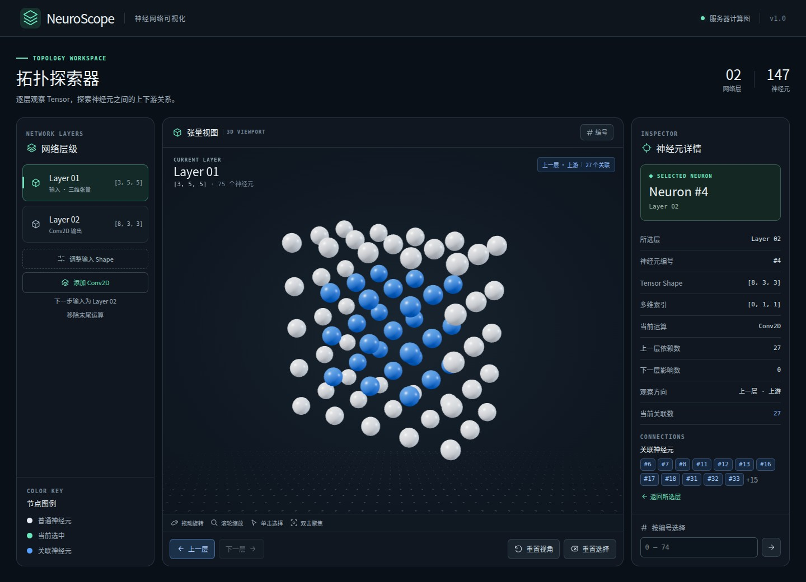

# NeuroScope

NeuroScope 是一个中文神经网络拓扑学习工作台。一个 Tensor 元素对应一个球体，点击球体可以查看它的编号、多维坐标，以及相邻层中和它有直接连接的节点。连接只通过颜色表达，画布不绘制神经元之间的连线。



## 先试一次

1. 初始显示 Layer 03 的 27 个白色球体。点击左侧 **Layer 02**，观察 `[4, 4]` 矩阵。
2. 点击第二行第二个球。它会变绿，右侧显示 **Neuron #5** 和索引 **[1, 1]**。
3. 点击 **上一层**。Layer 01 的 `#0、#1、#3` 变蓝，其余两个保持白色。
4. 直接点击 **下一层**。画布切换到 Layer 03，只有 `#8、#9、#10、#11` 变蓝。右侧仍显示 Layer 02 的 #5。点击 **返回所选层** 可以再次看到绿色球体。

| 操作 | 效果 |
| --- | --- |
| 拖动 / 滚轮 / 触控板双指缩放 | 绕当前目标旋转、改变观察距离 |
| 双击球体 | 选中该球，并将观察中心对准它 |
| 上一层 / 下一层 | 相对于保留的所选神经元查询上游或下游。到达首尾层时禁用越界方向 |
| 点击另一个球或关联编号 | 改选为正在显示的层中的新节点，可继续沿它的上下游探索 |
| 重置视角 / 重置选择 | 分别恢复整层取景、清除选中及蓝色高亮 |
| 编号 / 按编号选择 | 切换编号标签，或按扁平编号选中内部和被遮挡的节点。多于 80 个节点时仅显示所选编号 |
| 调整当前层 Shape | 修改观察层的形状，重建模拟连接并清除旧选择。刷新恢复默认网络 |

## Ubuntu 部署

以 root 登录 Ubuntu。项目安装在 `/opt/NeuroScope`。Nginx 监听公网 `16010`，将网页、静态文件和 `/api/` 请求统一转发到 `127.0.0.1:3010`。Node.js 提供网页和 API，systemd 负责开机启动与异常重启。

### 1. 准备环境

```bash
apt update
apt install -y git nginx curl ca-certificates
/usr/bin/node --version
npm --version
```

构建和测试需要 Node.js 22.13 或更高版本，推荐 Node.js 24。如果 `/usr/bin/node` 和 npm 已满足要求，直接进行下一步。新服务器可通过 NodeSource 安装 Node.js 24，其软件包提供 systemd 所用的 `/usr/bin/node`。[NodeSource 安装说明](https://github.com/nodesource/distributions)

```bash
curl -fsSL https://deb.nodesource.com/setup_24.x -o /tmp/neuroscope-node24-setup.sh
bash /tmp/neuroscope-node24-setup.sh
apt install -y nodejs
/usr/bin/node --version
npm --version
```

### 2. 获取代码并构建

首次安装执行下面的命令。

```bash
mkdir -p /opt
git clone --branch main https://github.com/LIKE9426334946/NeuroScope.git /opt/NeuroScope
cd /opt/NeuroScope
npm ci --include=dev
npm run build
```

如果 `/opt/NeuroScope` 已经是仓库，在该目录执行 `git pull --ff-only origin main`，然后执行同样的安装依赖和构建命令。若旧版正在运行，先按旧版 README 停止该项目，释放 `3010` 和 `16010`，再拉取代码。

### 3. 安装并启动 systemd 服务

```bash
cd /opt/NeuroScope
install -m 0644 deploy/NeuroScope.service /etc/systemd/system/NeuroScope.service
systemctl daemon-reload
systemctl enable --now NeuroScope.service
systemctl status NeuroScope.service --no-pager
curl --retry 5 --retry-connrefused --retry-delay 1 -fsS http://127.0.0.1:3010/api/health
```

健康接口返回 `{"status":"ok","service":"NeuroScope"}`。服务以 root 运行，生产入口为 `/usr/bin/node /opt/NeuroScope/backend/server.js`。

### 4. 启用 Nginx 公网入口

```bash
cd /opt/NeuroScope
install -m 0644 deploy/host-nginx.conf /etc/nginx/sites-available/NeuroScope
ln -sfn /etc/nginx/sites-available/NeuroScope /etc/nginx/sites-enabled/NeuroScope
nginx -t && systemctl enable --now nginx && systemctl reload nginx
curl --retry 5 --retry-connrefused --retry-delay 1 -fsS http://127.0.0.1:16010/api/health
```

浏览器打开 **http://服务器公网IP:16010**。若本机 `16010` 健康检查成功但公网无法访问，请检查云安全组与服务器防火墙是否放行入站 TCP `16010`。内部端口 `3010` 仅供本机访问。

### 5. 后续更新和日志

```bash
cd /opt/NeuroScope
git pull --ff-only origin main
npm ci --include=dev && npm run build && systemctl restart NeuroScope.service
curl --retry 5 --retry-connrefused --retry-delay 1 -fsS http://127.0.0.1:16010/api/health
journalctl -u NeuroScope.service -n 80 --no-pager
```

如果更新修改了服务文件或 Nginx 配置，先按第 3、4 步重新安装对应文件，并执行 `systemctl daemon-reload` 或通过 `nginx -t` 后重载 Nginx。

## 数据与坐标

默认层为 `[5]`、`[4, 4]`、`[3, 3, 3]`，共 48 个神经元。每层独立渲染。神经元 ID 由层编号与从 0 开始的扁平编号共同确定。

| Tensor | 空间布局 |
| --- | --- |
| `[W]` | 从左到右的一排球 |
| `[H, W]` | 按行、列排列，行号向下递增 |
| `[D, H, W]` | 沿深度放置 D 张 H 行 W 列的网格 |

最右维变化最快。`[3, 4, 5]` 生成 60 个球，编号 47 对应 `[2, 1, 2]`。支持 1–3 个维度，每一维必须是 1–30 的整数。最大单层 `[30, 30, 30]` 生成 27,000 个球。

Node.js 服务通过 `GET /api/network` 提供默认层定义。前端为每对相邻层生成可重复的稀疏模拟连接，每个目标节点最多取三个不同来源。每条记录有 `source_layer`、`source_neuron_index`、`target_layer`、`target_neuron_index` 四个字段。上下游索引从同一份记录建立，切换方向只查询索引。模拟连接仅用于学习，未加载 PyTorch 模型。API 暂时不可用时，页面会标明“内置模拟网络”，使用随包提供的相同默认层定义。

## 开发与验证

前端使用 React、TypeScript、Vite、Three.js、React Three Fiber、drei、Zustand 和 Tailwind CSS。WebGL2 可用时采用实例化球体渲染，缺少 WebGL2 时用同一套坐标、透视相机、轨道控制和颜色规则投影到 Canvas。两个渲染路径都支持拾取、旋转、缩放和聚焦。

在仓库根目录安装依赖后，开两个终端本地开发。

```bash
# 终端一，启动 127.0.0.1:3010 的 Node.js 服务
npm ci
npm start
```

```bash
# 终端二，启动 Vite 开发服务器
npm run dev
```

打开 Vite 输出的本地地址，`/api/` 将代理至 `127.0.0.1:3010`。执行 `npm test` 运行逻辑测试，`npm run build` 生成生产前端 `dist/`。构建后也可直接访问 `http://127.0.0.1:3010` 预览完整应用。`/api/docs` 提供接口说明和可以直接打开的 JSON 端点，`/api/openapi.json` 提供机器可读的接口定义。

| 路径 | 职责 |
| --- | --- |
| `shared/network.json`、`src/network/` | 默认层定义、配置加载 |
| `src/tensor/` | Shape 校验、扁平编号与多维索引转换、空间坐标 |
| `src/connections/`、`src/stores/` | 生成连接记录、双向索引、当前选择与观察方向 |
| `src/neuron/`、`src/scenes/` | 节点颜色策略、拾取、相机、渲染 |
| `src/components/` | 层列表、属性检查器和形状编辑器 |
| `backend/`、`deploy/` | Node.js 服务、systemd 单元和 Nginx 站点配置 |
| `tests/` | 坐标、边界、颜色、状态切换和 WebGL 浏览器回归 |

GitHub Actions 的 Ubuntu 验证任务会使用仓库中的 systemd 单元启动 Node.js 服务，再通过 Nginx 的 16010 端口在 Chromium 中检查真实 WebGL 画布、球体点击、蓝色像素、方向切换和双击聚焦。
